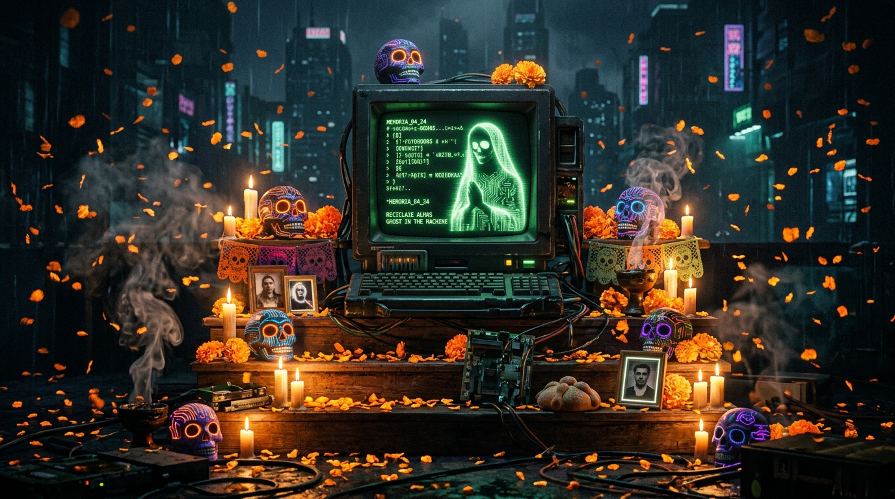
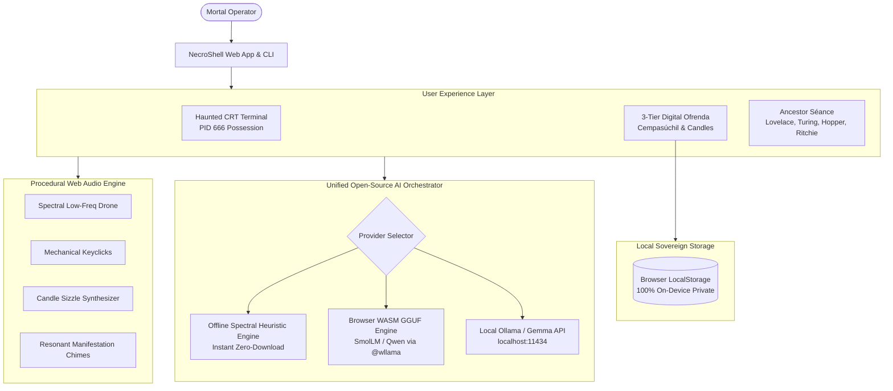

# 💀 NecroShell: Ghost in the Machine

> **An Open-Source AI Haunted Terminal, Digital Ofrenda & Ancestral Séance**  
> *Built for Hacktoberfest 2026 Open-Source AI Challenge: Week 4 ("Ghost in the Machine")*



[](https://opensource.org/licenses/MIT)
[](https://github.com/premmunot007-premmu/ghost-in-the-machine)
[](https://github.com/premmunot007-premmu/ghost-in-the-machine)
[](https://nodejs.org)

---

## 🔮 Overview

**NecroShell** bridges the spooky lore of **Halloween (October 31)** and the sacred remembrance of **Día de los Muertos (November 1 & 2)** through sovereign, local, open-source AI.

When the clock strikes midnight and the veil between the physical and digital planes thins, a phantom awakens inside the machine. NecroShell provides three deeply atmospheric, interconnected experiences:

1. **💻 The Haunted POSIX Terminal (`NecroTerminal`)**: A retro phosphor-CRT terminal possessed by **PID 666**. As you run standard commands (`ls`, `ps`, `cat`, `whoami`), the ghost intercepts inputs, alters system outputs, and whispers eerie commentary on mortal computing.
2. **🌼 The Digital Ofrenda (`Ofrenda Viva`)**: An interactive 3-tiered Mexican altar aglow with warm candlelight, falling cempasúchil (marigold) petals, traditional offerings (*pan de muerto, calaveras de azúcar, copal, agua pura*), and spirit memory cards. Features an **AI Calaverita & Eulogy Composer** that honors loved ones and computing ancestors.
3. **🔮 The Ancestor Séance (`The Chamber`)**: An offline spiritual circle channeling computing pioneers (**Ada Lovelace, Alan Turing, Grace Hopper, Dennis Ritchie**) and long-dead programming languages (**COBOL, ALGOL, LISP**) to discuss modern artificial intelligence, language obsolescence, and computational philosophy.
4. **🔊 Procedural Spectral Soundscape**: Built with the Web Audio API—generates eerie low-frequency wind drones, mechanical keyclicks, candle flame ignitions, and spiritual chimes in real-time with **zero external audio files**.
5. **⌨️ Native CLI Utility**: Run `npm run cli` directly in your physical terminal for full command possession and terminal séances.

---

## 🌐 Why Open Innovation Matters

In our DEV post and design manifesto, we center why open-source AI is essential for this project:

```
┌────────────────────────────────────────────────────────────────────────┐
│                      SOVEREIGN MEMORY MANIFESTO                        │
├────────────────────────────────────────────────────────────────────────┤
│ 1. SACRED DATA SOVEREIGNTY:                                            │
│    Family remembrances, ancestral photos, and personal eulogies should │
│    NEVER be uploaded to closed cloud servers or used to train corporate│
│    advertising models. Open AI keeps 100% of bytes on your laptop.    │
│                                                                        │
│ 2. OFFLINE IMMORTALITY:                                                │
│    When a stormy Halloween night cuts the power and internet, closed   │
│    APIs fail with HTTP 503. Open-weight models cached locally in RAM   │
│    or WebAssembly run indefinitely with zero connectivity.             │
│                                                                        │
│ 3. IMMUNITY TO SUNSETTING:                                             │
│    Proprietary APIs deprecate endpoints, change pricing, or shut down. │
│    A digital ofrenda built with open weights and MIT code will execute │
│    50 years from now without depending on a corporate balance sheet.   │
│                                                                        │
│ 4. ZERO MARGINAL COST:                                                 │
│    Closed models charge per-token fees on every keystroke and ghost    │
│    whisper. Sovereign local AI costs $0.00 forever.                    │
└────────────────────────────────────────────────────────────────────────┘
```

---

## 🏛️ Architecture & System Design



---

## 🚀 Quick Start

### Prerequisites
- Node.js `v20.0.0` or higher
- npm `v9.0.0` or higher
- *(Optional)* [Ollama](https://ollama.ai) running locally if you wish to link `gemma2:2b` or `qwen2.5:0.5b`

### 1. Clone & Install
```bash
git clone https://github.com/premmunot007-premmu/ghost-in-the-machine.git
cd ghost-in-the-machine
npm install
```

### 2. Run the Interactive Web Prototype
```bash
npm run dev
```
Open **`http://127.0.0.1:5173`** in your browser.

- Press **Sound: On** in the top bar to activate the procedural ambient drone.
- Type `help`, `whisper <query>`, or `curse` in the terminal.
- Switch to **Digital Ofrenda** to light candles and compose calaveritas for ancestors.
- Switch to **Ancestor Séance** to summon Ada Lovelace or Alan Turing.

### 3. Run the Standalone CLI in your Terminal
```bash
npm run cli
```
Or execute directly:
```bash
./bin/necro-shell.js
```

### 4. Run Automated Test Suite
```bash
npm test
```
Executes native Node.js test runner suites verifying all AI personas, contextual possession handlers, and calaverita generation.

### 5. Build for Production
```bash
npm run build
```
Creates a blazing-fast, minified static distribution in `dist/`.

---

## 🕯️ Terminal Commands Reference

| Command | Description |
|---|---|
| `help` | Reveal all available spectral and system commands |
| `whisper <msg>` | Converse directly with the ghost trapped in the machine |
| `seance <spirit>` | Summon Ada Lovelace, Alan Turing, Grace Hopper, Dennis Ritchie, or COBOL |
| `ofrenda` | Transition to the candlelit 3-Tier Día de los Muertos Altar |
| `chamber` | Enter the interactive Séance circle room |
| `curse` | Trigger a screen-shattering CRT glitch effect |
| `exorcise` | Purge static and restore calm to the machine |
| `possess [on\|off]` | Toggle active demonic shell interception |
| `ps / top` | Inspect phantom processes running in ancestral memory |
| `ls, cat, cd, pwd` | Explore the virtual file system and historical archives |
| `matrix` | Stream an eerie cascade of spectral runic glyphs |
| `ai [provider]` | Switch AI engine: `spectral`, `ollama`, or `wllama` |
| `clear, date, whoami` | Standard Unix utilities with a spooky twist |

---

## 📜 Ancestor Personas

- **Ada Lovelace (1815–1852)**: *First Computer Programmer*. Weaves poetry and mathematics, reflecting on how open neural weights mirror the Jacquard loom.
- **Alan Turing (1912–1954)**: *Father of Machine Intelligence*. Reflects on the imitation game, cryptanalysis, morphogenesis, and machine solitude.
- **Grace Hopper (1906–1992)**: *Rear Admiral & Mother of Compilers*. Feisty reflections on the Mark II moth, nanosecond wires, and fearless open-source experimentation.
- **Dennis Ritchie (1941–2011)**: *Creator of C & Unix*. Contemplations on simple primitives, pointers, operating system sovereignty, and community stewardship.
- **The Immortal COBOL (1959–Present)**: *The Undead Mainframe Ghost*. A hilarious, indestructible mainframe entity that refuses to die and balances world banking from beyond the grave.

---

## 📄 License

Distributed under the **MIT License**. See [LICENSE](LICENSE) for details.

*Honoring those who came before us on this Halloween & Día de los Muertos.* 🕯️🌼
